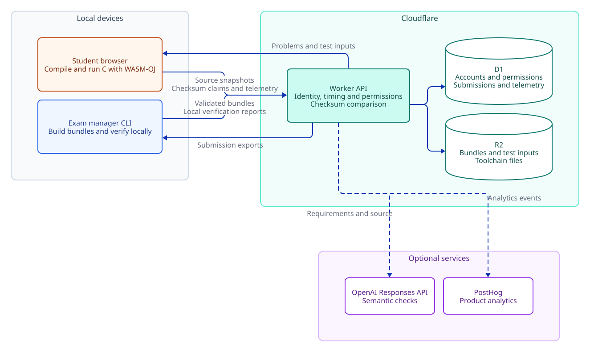

# Architecture and trust boundaries

Myriad runs code in students' browsers and on exam managers' devices. The Worker checks identities, exam times, and permissions, stores data, and compares checksums. Cloudflare does not execute uploaded C programs.

[Diagram source](diagrams/architecture.d2) and [rendering instructions](diagrams/README.md).

## Storage and data flow

| Location         | Stored data                                                                                                                                                                                     |
| ---------------- | ----------------------------------------------------------------------------------------------------------------------------------------------------------------------------------------------- |
| Student browser  | Drafts separated by sign-in provider, identity, exam, and problem; some interface preferences; a random device identifier; and cacheable toolchains                                             |
| D1               | Exam indexes and revisions, accounts and permissions, hashed session and CLI credentials, submitted source snapshots, claims, verdicts, semantic checks, manager reports, and browser telemetry |
| R2               | Uploaded problem bundles, test data, and shared toolchain files                                                                                                                                 |
| Manager's device | Problem source files, published versions in `.myriad/bundles/`, downloaded submissions, and rejudging results in `report/`                                                                      |

Submissions also record `CF-Connecting-IP` when available and a truncated User-Agent. Browser telemetry includes identity labels, random device IDs, exam activity, and performance data. Exam managers can analyze this data for their exams. Public submission summaries exclude source code, IP addresses, device associations, and raw telemetry.

Built-in telemetry and optional PostHog analytics use separate paths. Disabling PostHog does not stop D1 from recording submissions and browser telemetry. There is no general retention schedule or data-deletion management interface. Deployers must manage retention periods, backups, and data deletion themselves.

## Identity and permissions

Worker settings enable NYCU and Google sign-in independently. Both use a 24-hour HttpOnly session cookie after login. NYCU uses one-time state and S256 PKCE, and identifies accounts by the university's returned `username`. Google uses Firebase Authentication's REST authorization-code flow, binding a one-time Myriad login cookie to Firebase state, session ID, and context. The Worker verifies the Firebase token's signature, project issuer and audience, expiry, authentication time, and Google provider identity.

Accounts are identified by `(provider, subject)`. The Google subject comes from the signed `firebase.identities["google.com"]` claim, not a Firebase UID or email address. Myriad stores the Google account identifier and display name, but not Firebase or Google tokens or email. Firebase may separately retain profiles, email, and sign-in records. Myriad manages its own sessions: disabling or deleting a Firebase user, or revoking Firebase tokens, does not immediately invalidate existing Myriad sessions or personal CLI credentials. Cookie-authenticated management writes require an `Origin` header that matches the application's origin.

Guests supply their own identifiers, with no authentication guarantee. Guests using the same identifier in the same exam share that identifier's summaries and cooldown scope. NYCU, Google, and guest identities have distinct participant IDs; matching text does not merge them. A Google account does not automatically inherit an NYCU account's permissions through a matching email address. Public summaries cannot restore drafts or source code across devices.

| Permission              | Scope                                                                                                    |
| ----------------------- | -------------------------------------------------------------------------------------------------------- |
| Platform administrator  | Manage exam-creation grants and upload toolchains; OAuth administrators are listed in `ADMIN_IDENTITIES` |
| Exam-creation grant     | Create new exams and become their owner                                                                  |
| Exam owner              | Manage a specific exam and invite or remove collaborators                                                |
| Exam collaborator       | Edit, publish, preview, export, and rejudge an invited exam; cannot delegate permissions                 |
| Personal CLI credential | Use the account's existing permissions; individually revocable and grants no additional permissions      |

`ADMIN_TOKEN` is a separate platform service credential. It is not an exam owner's credential and should not be distributed to ordinary exam managers. Revoking an exam-creation grant only prevents new exams. To revoke existing collaboration access, remove the member from the exam.

## Judging and versioning

The CLI runs reference solutions and writes digests of normalized expected output into the bundle. The browser downloads the full test inputs, compiles and runs student code, and returns checksums bound to the exam salt, identity, problem, and test index. The Worker compares these checksums and saves the test verdicts.

The browser and its reports are untrusted. Checksum binding prevents values from being reused directly across identities, problems, or tests. It does not prove that the submitted source was executed or that reported performance is accurate. After the exam, `verify` reruns saved code against the corresponding bundle on the manager's device. Differences and device associations are evidence for investigation; they do not automatically establish cheating.

A bundle's `revision` identifies the entire publication. Each problem's `version` identifies the toolchain, tests, limits, groups, and implementation requirements that affect judging. Changes to descriptions, titles, or templates alone do not change the problem version. Every submission records its revision and problem version. Attempts already started can finish against their original version. Managers must retain past bundles for rejudging.

When a submission is created, the Worker first saves the source snapshot and cooldown state, then issues that attempt's write credential. Requests can be retried with the same operation ID. Resending an identical claim does not score it twice; conflicting claims are rejected. After an interruption, uploads resume from the test state already saved by the server.

## Exam access and previews

Before an exam starts, only exam information is public; the actual problems and tests are unavailable. Signed-in owners and collaborators can use the student interface through an explicit preview request. Preview submissions are excluded from student statistics, exports, and rejudging. Pre-exam preview submissions are cleared after the exam starts.

While an exam is open, browsers can retrieve test inputs, including earlier problem versions. After the deadline, student APIs reject access to problems, tests, submission summaries, and new submission operations. Myriad cannot retract data already downloaded, saved, or cached. There is no post-exam results page for students. Only exam managers can access rejudging reports.

## Optional external services

Problems with `semanticCheck` call the OpenAI Responses API. Requests send the manager's requirements and the first 20,000 Unicode characters of student code, with `store=false`. They do not separately include student identifiers or tests, though the code itself may contain personal data written by its author. Default models and parameters are defined in [`semantic.ts`](../apps/worker/src/semantic.ts); deployers can select an available, compatible model with `OPENAI_SEMANTIC_MODEL`. If the service fails, Myriad keeps the test results for a retry. A service failure must not be treated as a student failing the requirements. If the semantic check finds that the code fails the requirements, the attempt's score is zero. Local rejudging retains the saved semantic result.

PostHog is enabled when the corresponding project keys are configured. The browser sends analytics events through the same-origin `/ingest` proxy. The Worker can also send product, error, and model-usage events. Account analytics identifiers are pseudonymized with HMAC. Semantic analytics replace code fields with character counts, but include implementation requirements, results, and the model's reasons. Browser input masking and sensitive-area exclusions do not replace the deployer's review of complete events, errors, network data, and recording settings. The proxy removes Myriad cookies and may forward the source IP supplied by Cloudflare. See the [deployment guide](deployment.md) for setup.
