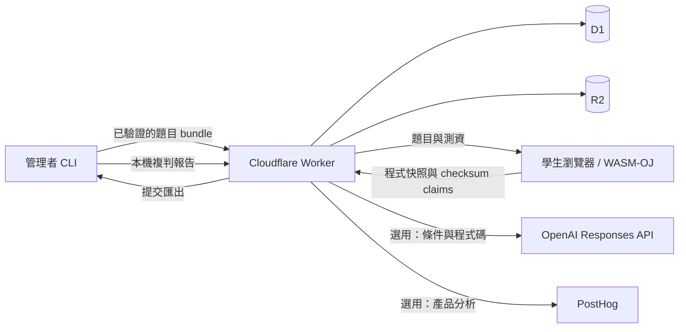

# 架構與信任邊界

Myriad 將程式執行放在學生瀏覽器與管理者裝置。Worker 負責身分、時間與權限檢查、資料保存及 checksum 比對；Cloudflare 不執行上傳的 C 程式。

## 儲存與資料流

| 位置       | 保存內容                                                                                                             |
| ---------- | -------------------------------------------------------------------------------------------------------------------- |
| 學生瀏覽器 | 依登入方式、身分、考試與題目隔離的草稿、部分介面設定、隨機裝置識別及可快取的工具鏈                                   |
| D1         | 考試索引與版本、帳號與權限、雜湊後的 session／CLI 憑證、提交程式快照、claims、判定、語意檢查、管理者報告與瀏覽器遙測 |
| R2         | 上傳的題目 bundle、測資與共用工具鏈檔案                                                                              |
| 管理者裝置 | 題目原始檔、`.myriad/bundles/` 發布版本、下載的提交及 `report/` 複判結果                                             |

提交也保存可取得的 `CF-Connecting-IP` 和截短的 User-Agent；瀏覽器遙測包含身分標籤、隨機裝置 ID、作答事件及效能數據。這些資料供該考試管理者分析。公開提交摘要不包含原始碼、IP、裝置關聯或原始遙測。

內建遙測與選用的 PostHog 是不同路徑：關閉 PostHog 不會關閉 D1 中的提交與瀏覽器遙測。專案沒有通用的資料保留排程或刪除管理介面；部署者需自行管理保存期限、備份和資料移除。

## 身分與權限

NYCU 與 Google 登入由 Worker 設定各自啟用，登入後共用 24 小時 HttpOnly session cookie。NYCU 使用一次性 state 與 S256 PKCE，以校方回傳的 `username` 識別帳號。Google 透過 Firebase Authentication 的 REST 授權碼流程，將一次性的本站登入 cookie 與 Firebase state、session ID 及 context 綁定。Worker 驗證 Firebase token 的簽章、專案 issuer／audience、有效期、驗證時間及 Google provider 身分。

帳號以 `(provider, subject)` 識別；Google subject 取自已簽章的 `firebase.identities["google.com"]`，不是 Firebase UID 或 email。Myriad 只保存 Google 帳號識別與顯示名稱，不保存 Firebase／Google token 或 email；Firebase 可能另外保存 profile、email 與登入紀錄。本站 session 由 Myriad 管理，在 Firebase 停用或刪除使用者、撤銷 token，不會立即使既有 Myriad session 或個人 CLI 憑證失效。Cookie 認證的管理寫入要求同源 Origin。

訪客識別由使用者自行填寫，沒有認證保證。同一考試的同名訪客共用該識別下的摘要與冷卻範圍。NYCU、Google 與訪客身分有不同 participant ID，相同文字不會合併。Google 帳號也不會因 email 與 NYCU 帳號相同而自動取得其權限。公開摘要不能用來還原跨裝置草稿或程式碼。

| 權限           | 範圍                                                                 |
| -------------- | -------------------------------------------------------------------- |
| 平台管理員     | 管理建立考試許可、上傳工具鏈；OAuth 管理員由 `ADMIN_IDENTITIES` 指定 |
| 建立考試許可   | 建立新考試，建立者成為 owner                                         |
| 考試 owner     | 管理指定考試、邀請或移除共同管理者                                   |
| 考試共同管理者 | 修改、發布、預覽、匯出與複判獲邀考試，不能轉授權限                   |
| 個人 CLI 憑證  | 使用原帳號現有權限，可個別撤銷，不新增權限                           |

`ADMIN_TOKEN` 是獨立的平台服務憑證，不是某個考試的 owner 憑證，也不應配發給一般管理者。撤銷建立許可只阻止新建考試；要撤銷既有共同管理資格需另外移除成員。

## 判題與版本

CLI 執行標準解，將正規化後的預期輸出摘要寫入 bundle。瀏覽器下載完整測試輸入、編譯並執行學生程式，回傳與考試 salt、身分、題目及測試索引綁定的 checksum。Worker 比對 checksum 後保存測試判定。

瀏覽器及其回報內容均不可信。Checksum 綁定可避免直接混用不同身分、題目及測試的值，無法證明提交的原始碼曾執行，也無法證明效能回報真實。考後 `verify` 使用保存的程式與對應 bundle 在管理者裝置重新執行；差異和裝置關聯是調查資料，不會自動認定作弊。

Bundle 的 `revision` 識別整次發布；每題的 `version` 識別影響判題的工具鏈、測資、限制、分組與實作要求。單純修改敘述、標題或模板不改變題目版本。每筆提交保存其 revision 與題目版本，已開始的提交可依原版本完成。管理者需保留歷次 bundle 才能對應複判。

建立提交時先保存程式快照與冷卻狀態，再發給該次 attempt 的寫入憑證。相同 operation ID 可重試；相同 claim 重送不重複計分，衝突 claim 拒絕。中斷後依伺服器已保存的測試狀態續傳。

## 開放期間與預覽

考前只公開考試資訊，不提供正式題目與測資；已登入的 owner 或共同管理者可經明確的預覽請求使用學生介面。預覽提交不列入學生統計、匯出及複判，考試開始後清除考前的預覽提交。

開放期間瀏覽器可取得測試輸入，包含歷次題目版本。截止後學生 API 拒絕題目、測資、提交摘要及新提交操作，但無法撤回已下載、另存或快取的資料。系統沒有學生考後成績頁；複判報告只供考試管理者使用。

## 選用外部服務

設定 `semanticCheck` 的題目會呼叫 OpenAI Responses API，傳送管理者的條件及學生程式前 20,000 個 Unicode 字元，以 `store=false` 請求判斷；不另附學生識別或測資。程式本身可能包含使用者寫入的個人資料。預設模型與參數由 [`semantic.ts`](../apps/worker/src/semantic.ts) 定義，部署者可透過 `OPENAI_SEMANTIC_MODEL` 指定相容且可用的模型。服務失敗會保留測試結果等待重試，不能直接當作學生不符合要求。語意未通過時該次得分為零；本機複判保留已保存的語意結果。

PostHog 在設定相應 project key 後啟用。瀏覽器透過同源 `/ingest` 代理送出分析事件，Worker 可另送出產品、錯誤及模型使用事件。帳號分析識別使用 HMAC 化名；語意分析的程式碼欄位以字數替代，但會包含實作要求、結果與模型原因。瀏覽器輸入遮罩與敏感區域排除不能代替部署者對完整事件、錯誤、網路資料及錄影設定的檢查。代理移除本站 cookie，並可轉送 Cloudflare 提供的來源 IP。設定方式見 [部署指南](deployment.md)。
